

WO4K is a modern Windows mod for **WipEout 2097 / XL**, by Ninja Dynamics.
It adds widescreen rendering, smooth animation, extended track visibility,
HD interface artwork, modern controllers and local PC/PlayStation soundtracks
while retaining the original game's 30 Hz simulation and gameplay pace.

[Download releases](https://github.com/ninjadynamics/wo4k/releases) ·
[Source code](https://github.com/ninjadynamics/wo4k) ·
[Report a bug](https://github.com/ninjadynamics/wo4k/issues)

This repository contains the mod's source code, artwork, Makefile and installer
scripts. Compiled EXEs/DLLs and other generated build outputs are excluded from
Git. Ready-to-use ZIP packages and their SHA-256 checksums belong in
**Releases**. To play, download a release ZIP rather than GitHub's automatic
“Source code” archive.

## Features

- Any-aspect-ratio rendering, corner-aligned HUD and adapted menu layouts.
- Rendering at high refresh rates, interpolated animation, crossfaded sprite
  animation and smooth menus, menu models and credits.
- Extended track visibility and corrected effect placement/transparency.
- PS1 blend choices for shared explosions/flashes (additive) and smoke
  (subtractive), with original sprite silhouettes and smooth animation.
- During a race, press **+ / −** (main keyboard or numpad) to adjust shadow
  lift in the 3D lighting. Each tap changes it by 5%, from 0% (original) to
  300%. **Page Up / Page Down** adjusts highlights from 0–300%, with 100%
  retaining their original level. A brief readout shows both saved values.
  Menus, HUD and blended materials retain their original colors/transparency.
- HD fonts, HUD, notice and title artwork, with original SD assets retained.
- Restore full-colour road materials from original tiles already in the PC
  data. An optional European PS1 disc adds original texture/sprite sources;
  selection follows a fixed, project-audited map with byte-identical PC reuse.
- SDL3 gamepad support, including DualSense over USB or Bluetooth.
- PC music plus an optional PlayStation soundtrack, switchable during play.
- Local sound-effect noise reduction at the original 22.05 kHz sample rate,
  with volume compensation.
- Portable installation: no disc mounting, fixed drive path or registry setup.

## Requirements

**Windows 10/11 x64** and your own supported **Windows PC game files** are
required. Supply one PC ZIP/disc image, or the small **11 MB PC version**.
Setup extracts any PC music included with that source automatically.

Music is optional. The small version can run with sound effects only, or with
an optional PlayStation soundtrack. The European PS1 disc (SLES-00327) also
supplies original artwork. A data-only ISO works for artwork without music;
PS1 data cannot replace the Windows executable. There is no separate PC
soundtrack field. See [native texture selection](docs/NATIVE-TEXTURES.md).

Setup accepts game folders, ZIP archives and supported ISO, MDS/MDF or CUE/BIN
images. Keep paired disc files together. Data-only ISOs and small PC downloads
contain no CD audio; choose **No music**, or add a PlayStation soundtrack.
Supported executable checksums are listed in [manifests/patches.json](manifests/patches.json);
unsupported binaries are rejected before an installation is committed.

## Install and play

1. Download a ZIP from [Releases](https://github.com/ninjadynamics/wo4k/releases)
   and extract it into a writable folder outside Program Files.
2. Open **Setup.exe**. It searches common local folders in the background.
   Use the browse button to select a file/folder or the animated ✨ button to
   search again. No match leaves a field silently empty; controls have tooltips.
3. Select the PC game source once. Optionally add a PlayStation game source,
   then choose available PC/PlayStation music or **No music**.
4. Choose **Audio output** (Mono, Stereo or Dolby Surround),
   **Fullscreen mode** (Borderless or Exclusive), **Install HD artwork**
   and **Improve audio quality** as desired,
   then click **Install / repair**.
5. Click **Play**, or run **Play.exe**. The original display-selection screen
   is bypassed; WO4K renders at your display's resolution and aspect ratio.

Change **Audio output** in Setup anytime. It saves automatically for the next
launch without reinstalling; Stereo is the default.
**Fullscreen mode** also saves for the next launch without reinstalling.
Borderless is the default and fills the display without a window border;
Exclusive uses exclusive fullscreen presentation.

Change soundtracks on the fly in **Options → Audio** when both banks are
installed. Your choice is saved. The PC bank contains nine songs; the optional
PlayStation bank contains eleven.

Every Play launch runs the artwork and sound-effect installers first. Edit HD
PNGs in `assets/hd/` to have them picked up at the next launch. Audio outputs are rebuilt when changed or damaged; HD PNGs are validated and
read directly by the renderer. Setup's HD/audio
preferences are respected. Original effects stay locally in `wobble/audio/source/`,
so refresh never repeatedly denoises its own output or needs the disc again.
Native road/PS1 improvements are built into the packed SD sheets during setup
and retained locally. Setup saves source paths and preferences in `.state/setup.json`.
Before launching, Play checks the configured installation, synchronizes updated
runtime files, imports missing PS1 artwork/music, and repairs missing or damaged
outputs. Setup runs the same check when opened. Healthy installed assets and
cached PS1 artwork remain usable when the original disc is offline; restoring
missing music or PC data may require the configured source again.
Texture choices are fixed at project time; launch checks verify installed output
integrity without comparing PC and PS1 quality.
Play scans `assets/hd/` on every launch and validates every PNG. All eleven
exported UI filenames are supported: `font-and-numbers`, `hud-gauges`,
`hud-reticles`, `menu-background`, `menu-frame-left/middle/right`,
`menu-controls-1/2`, `menu-logo-atlas`, and `menu-banner-logo` (all `.png`).
`notice.png` and `title.png` retain their startup layouts.

Additional native TGA replacements work without a rebuild: use the original
name, such as `SKY01.png`, or `HUD2.page0.png` for a zero-based individual page.
A whole multi-page replacement such as `HUD2.png` retains the original
horizontal page strip. Native filenames can also mirror `Pics/Hi-res/` under
`assets/hd/`. Exported semantic names take priority over generic native names;
`menu-banner-logo.png` overlays only the logo regions of `menu-logo-atlas.png`,
keeping the atlas's buttons/panels (or their SD originals).
The HD header is joined in memory and drawn as one rectangle, allowing smooth
filtering across the original atlas split without a visible seam.

Keep each exported atlas's canvas and element positions. Atlas pages are square,
power-of-two, 256..8192 pixels; joined banners retain the exported 462:64 ratio.
Unmapped or invalid PNGs produce a clear error naming the file, rather than
silently being skipped. Restart Play after changing artwork. The renderer uses
premultiplied color for filtering/blending, preserving smooth edges and fades;
your PNG files stay unchanged.

HD PNGs live only in assets/hd; the runtime reads them directly, with no BMP,
RGBA or PNG copies in Wobble. Play applies layout migrations and removes known
obsolete mod outputs before every launch, including after Update. Custom files,
saves and preferences are preserved. Close the game before changing assets.

## Videos

Setup extracts all five original PC videos to `wobble/movies/` when your source
includes them. Startup runs in this order: **launcher → notice → intro → title**.
The four endings play on their original completion events: six gold medals
(XTRO1), the Phantom challenge (XTRO2), eight gold medals (XTRO3), and the Piranha
challenge (XTRO4). Original achievement and save handling stays in the game.

Drop in `intro.mp4` (or `WXLINTR.mp4`), `XTRO1.mp4`, `XTRO2.mp4`, `XTRO3.mp4`,
or `XTRO4.mp4` to replace any video, including with HD artwork. MP4 takes priority;
the corresponding original `WXLINTR.MPG` / `XTRO1.MPG`–`XTRO4.MPG` is the fallback,
including when Windows cannot decode a replacement. Setup preserves your MP4
replacements. When ffmpeg is available on PATH, Setup and Play convert the five
original MPEGs to H.264/AAC MP4, validate them, and remove the copied MPEG
intermediates. Without an encoder, original MPEG playback remains available.
Videos fit the screen without stretching. Skip with **Esc**,
**Enter**, **Space**, or a controller button. The cursor stays hidden during
videos and in-game, and movies have no tooltip. Music pauses during cutscenes.

The small PC download works without movies; missing files or unavailable Windows
media codecs do not block the game. Movie files are supplied by you and never
included in the mod release. Run **Install / repair** with your PC disc/ZIP to
add movies to an existing installation. No disc needs to stay mounted afterward.

The title-screen attract timer uses real elapsed time: 30 seconds on the first
visit and 5 seconds on later visits. When a controller is detected, the prompt
changes to **Press start**; Start/Options continues, as does Cross. Keyboard
users retain **Press enter**.

## Controls

PlayStation button names below describe SDL3's corresponding controller positions.
Keyboard input remains available.

| Control | Action |
| --- | --- |
| Cross | Accelerate / confirm |
| Square | Fire / go back in menus |
| Left stick | Turn / pitch |
| L2 / R2 | Left / right analog air brake |
| D-pad | Menu navigation |
| Triangle | Discard weapon |
| Circle / F1 | Change camera |
| Options / Start | Continue from title / pause in game |
| R1 + Square | Fire a rear-locked missile |
| Backtick (`) | Toggle the bottom-center FPS counter |
| F4 | Cycle exhaust trails: off / simple / full |

Full trails are the default. FPS visibility and trail selection are remembered.

## Updates and links

The **GitHub** logo opens this source repository. **Update** uses Windows
`curl.exe` to download and verify a newer release, backing up changed files and
preserving installed game data, audio, saves, preferences and URL configuration.
It finishes with **Install / repair**, even when the latest release is already
installed. Downloading a release ZIP and overwriting the mod folder is also
supported: the next Play or Setup launch reconciles the installation locally.
Both launchers remove retired, unchanged mod-owned files and empty directories
using the previous release inventory. Modified/custom files and saves are kept.
Close the game before updating; reopen Setup afterward to load interface changes.
It does not check for updates or download anything automatically at startup.

The supplied plain-text configuration files contain one HTTPS URL each:

| File | Default |
| --- | --- |
| `source.url` | https://github.com/ninjadynamics/wo4k |
| `release.url` | https://github.com/ninjadynamics/wo4k/releases/latest |

Missing, empty, unreadable or invalid files silently disable their controls.
The configured latest-release endpoint follows GitHub's latest full release;
GitHub prereleases are available manually on the Releases page. See
[release/update details](docs/UPDATES.md) for verification and publishing rules.

## Files and local data

The package contains the mod's code/runtime, checksum-guarded executable binary
differences, supplied HD artwork and licensed compatibility/controller dependencies.
It does not contain an original game executable, game data, music or sound effects.
Setup reads your source files without modifying them and patches your executable
locally. Installation needs no network, administrator access, external installer,
Python or FFmpeg. The optional Update action downloads mod releases.

```text
assets/hd/                   editable supplied HD PNGs
scripts/                     PowerShell setup, extraction, install and build tools
src/                         C runtime, controller, audio and launcher source
runtime/                     built mod runtime and dependencies
patches/                     checksum-guarded binary differences
wobble/                      created locally by Setup
  Wipeout2097.exe             patched from your supplied PC executable
  music/pc/                  PC soundtrack
  music/psx/                 optional PlayStation soundtrack
  audio/                     sound effects; source/ retains original inputs
  textures/sd/               original artwork/texture containers
```

Repairs stage an installation before replacing it, preserve saves/preferences and
retain the previous installation in `backups/`. Successful extraction sessions
are cleaned; failed sessions in `.work/` and `logs/` help diagnose problems.
Installed game files, private work, logs, backups, exports and `dist/` release
artifacts are excluded from Git. Keep the mod folder together when moving it.

## Source, tools and builds

All setup, extraction, installation, build and verification scripts are `.ps1`.
Setup.exe and Play.exe are thin launchers for Windows PowerShell 5.1. The audio
processor is included as C source and processes effects locally during setup.

- [Standalone extraction and installation commands](docs/TOOLS.md)
- [How to compile: Makefile or optional local WinGet bootstrap](HOW-TO-COMPILE.md)
- [Build dependencies and release assembly](docs/BUILD.md)
- [Updater configuration and release publishing](docs/UPDATES.md)
- [Changelog](docs/CHANGELOG.md)

Use `make` with an existing toolchain, or optional `.\compile.ps1` to fetch
missing compilers/Make into `.tools/` and run Make. `make release` builds,
tests and packages. Pushing a matching version tag triggers the GitHub Actions
release workflow; a normal branch push updates source only.

Build scripts write the distributable ZIP, checksum and file inventory under
`dist/`. Publish the ZIP and its `.zip.sha256` sidecar together in this repository's
Releases; GitHub's generated source archives are not update packages.

Every launch, installation and update writes a local diagnostic log in `logs/`.
If an operation fails, a popup shows the exact log location; launch failures
include the Windows error or game exit code. The native launchers also capture
PowerShell startup/parse errors. If the mod folder is unwritable, the popup
points to a fallback log under `%TEMP%/WO4K`.

Support logs include Windows edition/build/architecture, CPU model and core
counts, RAM capacity, GPU model/driver, and the mod version and startup stages.
They do not query machine/account names, serial numbers, UUIDs, MAC/IP addresses
or hardware device IDs. Common personal paths are redacted in script logs;
bootstrap errors may include script paths. Logs stay local and are never
uploaded automatically. Review them before sharing.

Existing players: click **Update**, close and reopen Setup to load its updated
interface, then **Install / repair** if needed and **Play**. Logging is automatic;
there is no diagnostic option to enable. Update already refreshes the installed
runtime and preserves saves/preferences.

WO4K is a beta. Report the mod version, Windows version, source type, symptoms
and relevant `logs/` through [Issues](https://github.com/ninjadynamics/wo4k/issues).

## Acknowledgements

Huge thanks to the people who made this work possible:

- **Yash-Singh1 and contributors — [wipeout-xl-decomp](https://github.com/Yash-Singh1/wipeout-xl-decomp).**
  This repository covers WipEout XL / 2097 on PlayStation and includes a partial
  PC decompilation. Its PC source was a valuable reverse-engineering reference
  for locating and understanding the original game's routines while building WO4K.
- **[DDrawCompat](https://github.com/narzoul/DDrawCompat), by narzoul and contributors,**
  for the compatibility layer that makes the original rendering APIs usable on
  modern Windows.
- **[SDL3](https://github.com/libsdl-org/SDL) and its contributors,** including
  its HIDAPI integration, for modern controller support.
- The original **Psygnosis developers, artists, musicians and designers**, and
  the WipEout community keeping these games alive.

Third-party licensing and artwork attribution remain documented in
[licenses/](licenses/) and [manifests/](manifests/).

Our contributions are MIT licensed; see [LICENSE](LICENSE). Artwork provenance
and third-party licenses are recorded in [manifests/](manifests/) and
[licenses/](licenses/). WipEout is credited to its original creators.
WO4K is an independent mod.
